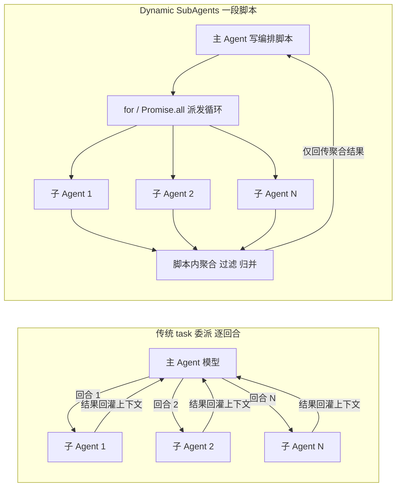
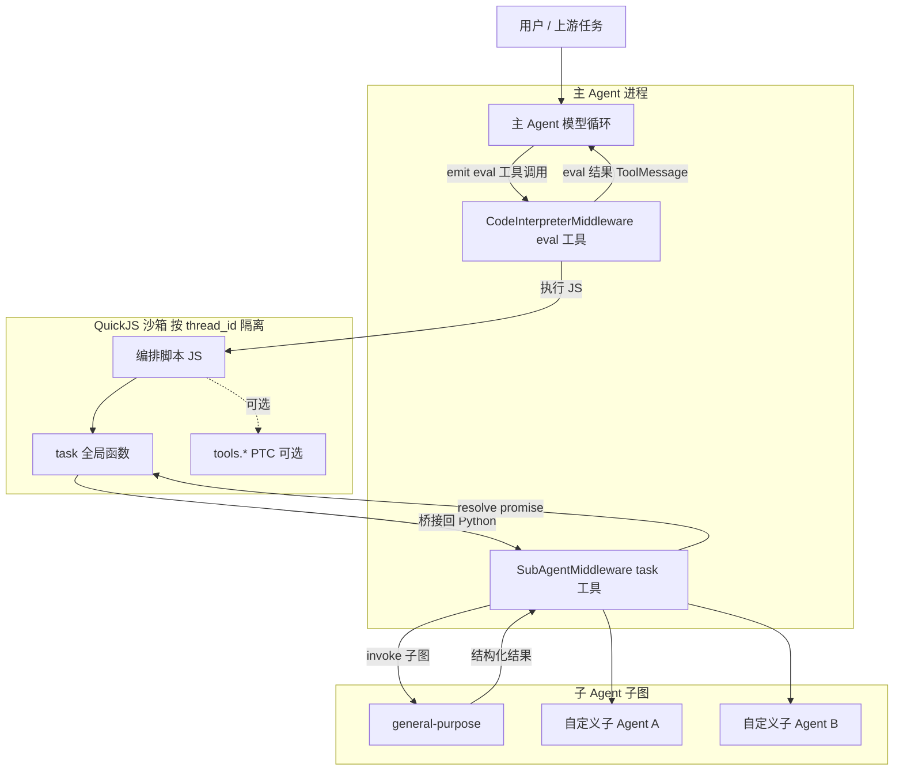
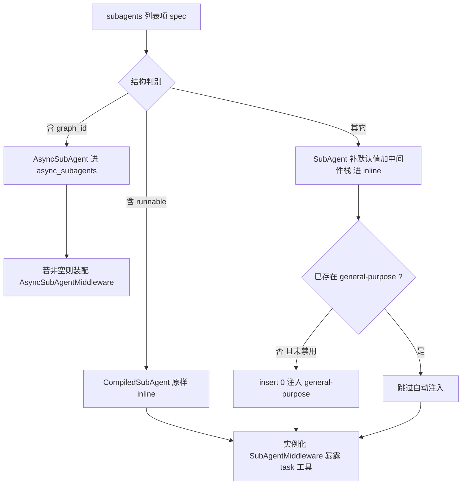
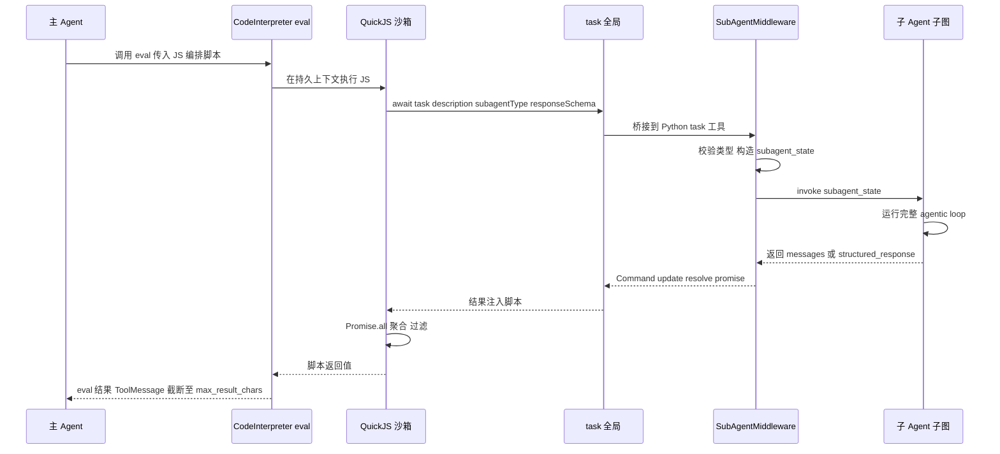
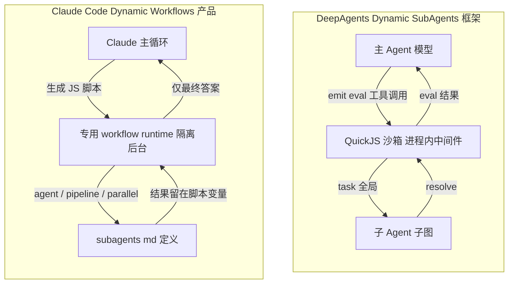

> 💡 **一句话概括：**Dynamic SubAgents 把「子 Agent 编排」从**主 Agent 逐回合的隐式推理**升级为**一段在沙箱里确定执行的编排代码**。主 Agent 写出一段 JS 脚本，脚本里用内置的 `task()` 全局函数、配合 `for` 循环 / 条件分支 / `Promise.all` 并行，把任务成批派发给已注册的子 Agent，并在脚本内直接聚合结果。
>
> 本文基于 [langchain-ai/deepagents](https://github.com/langchain-ai/deepagents/tree/main) 源码与 LangChain 官方文档撰写，力求「以图表代替文字堆砌」。

# 1. 一图看懂：两种委派模式的差别

传统 `task` 委派：主 Agent 每个回合只发起一次委派，编排逻辑存在于「模型的脑子里」。Dynamic SubAgents：主 Agent 一次性写出编排脚本，由沙箱确定执行。



| 维度 | 传统 task 委派 | Dynamic SubAgents |
|-|-|-|
| 编排载体 | 模型逐回合的隐式推理 | 一段可执行的 JS 编排脚本 |
| 并发 | 一回合可并列多个 task，但仍受模型「同时想起几个」限制 | `Promise.all` 显式扇出，覆盖由代码保证 |
| 大规模覆盖 | 易「检查 500 项里的 75 项就收工」 | 循环遍历，全覆盖由代码而非模型判断保证 |
| 上下文占用 | 每次委派的过程都回灌主上下文 | 中间过程留在脚本，仅聚合结果回传 |
| 复杂流程 | 多阶段 / 条件分支需模型逐轮「复现」，易漏步 | 分支、阶段、重试写成代码，确定执行 |

# 2. 核心概念速查

| 概念 | 归属 | 作用 |
|-|-|-|
| `SubAgentMiddleware` | deepagents 仓库<br/>middleware/subagents.py | 注册 `task` 工具；把子 Agent 编译成可调用子图 |
| `task` 工具 | 同上 | 校验 subagent_type、构造子状态、invoke 子图、回传结果 |
| `CodeInterpreterMiddleware` | 独立包 langchain-quickjs | 注册 `eval` 工具，在 QuickJS 持久上下文执行 JS |
| `task()` 全局 | 解释器注入（顶层全局） | 在 JS 内派发子 Agent，桥接回 Python 的 task 工具 |
| PTC（tools.\*） | 解释器可选能力 | 在 JS 内直接调用普通工具，默认关闭，需白名单 |
| QuickJS 沙箱 | quickjs-rs | 按 thread_id 隔离，限内存 / 超时，无环境能力 |

> 💡 **重要区分：**「Dynamic Subagents（解释器路径）」依赖的 `CodeInterpreterMiddleware` **不在** deepagents 仓库里，而是独立 PyPI 包 [langchain-quickjs](https://pypi.org/project/langchain-quickjs/)，通过 `create_deep_agent(..., middleware=[CodeInterpreterMiddleware()])` 装配。它与仓库内的 `AsyncSubAgentMiddleware`（远程 Agent Protocol 后台任务，另一条路）不是一回事。

# 3. 整体架构

三层协作：主 Agent 进程内的两个中间件（解释器 + 子 Agent）+ 独立的 QuickJS 沙箱 + 一组子 Agent 子图。



| 组件 | 源码位置 | 职责 |
|-|-|-|
| `create_deep_agent` | libs/deepagents/deepagents/graph.py | 装配所有中间件、路由子 Agent、注入 general-purpose |
| `SubAgentMiddleware` | libs/deepagents/deepagents/middleware/subagents.py | 构造并暴露 `task` 工具 |
| `CodeInterpreterMiddleware` | langchain-quickjs（独立包） | 注册 `eval`，托管 QuickJS 上下文 |
| `AsyncSubAgentMiddleware` | middleware/async_subagents.py | 远程后台子 Agent（非解释器路径） |

组件对应源码见 [graph.py](https://github.com/langchain-ai/deepagents/blob/main/libs/deepagents/deepagents/graph.py) 与 [subagents.py](https://github.com/langchain-ai/deepagents/blob/main/libs/deepagents/deepagents/middleware/subagents.py)。

# 4. 原理

## 4.1 双层桥接：JS 世界 ↔ Python 世界

Dynamic SubAgents 的关键是一条「JS 全局 → Python 工具 → 子图」的桥。主 Agent 从不直接调子图，而是写脚本让沙箱代为派发。

| 层 | 对象 | 说明 |
|-|-|-|
| JS 层 | `task({description, subagentType, responseSchema})` | 顶层全局函数，返回 Promise，resolve 为子 Agent 最终结果 |
| 桥接层 | host function bridge | 把 JS 调用转发到 Python 的 `task` StructuredTool |
| Python 层 | `task` / `atask` 闭包 | 校验类型、构造子状态、`subagent.invoke()` |

## 4.2 变量持久化：mode 的三档语义

| mode | 顶层 let/const/function 的生命周期 | 典型用途 |
|-|-|-|
| `thread`（默认） | 跨 `eval` 调用、且跨回合持久（同一 thread_id） | 多轮迭代、渐进式编排 |
| `turn` | 仅在单个回合内的多次调用间持久 | 单回合复杂编排 |
| `call` | 每次 `eval` 全新 REPL，不保留 | 一次性、无状态脚本 |

## 4.3 并行与预算

- 并行：脚本用 `await Promise.all([task(...), task(...), ...])` 扇出；桥接层对每个 REPL 有并发上限；顶层不可解析的 promise 会抛 `Deadlock`。
- 沙箱限制：默认 `memory_limit=64MB`、`timeout=5.0s`、`max_result_chars=4000`（结果截断）。
- PTC 预算：`max_ptc_calls=256`/次 eval，超出抛 `PTCCallBudgetExceeded`。

以上解释器配置与语义以 [langchain-quickjs](https://pypi.org/project/langchain-quickjs/) 及 [Dynamic subagents 文档](https://docs.langchain.com/oss/python/deepagents/dynamic-subagents) 为准。

# 5. 实现流程（源码分析）

## 5.1 SubAgentMiddleware 与 task 工具（subagents.py）

| 关键函数 / 结构 | 行为 |
|-|-|
| `SubAgentMiddleware.__init__` | 接收 backend、subagents 等；subagents 为空则抛 ValueError；`_build_task_tool` 构造工具并挂到 `self.tools` |
| `_build_task_tool` | `StructuredTool.from_function(name="task", func=task, coroutine=atask, args_schema=TaskToolSchema)` |
| `TaskToolSchema` | 模型可见参数：`description: str`、`subagent_type: str`（runtime 注入不可见） |
| `task()` 闭包 | 1) 校验 subagent_type；2) `_validate_and_prepare_state` 复制父状态并剔除 `{messages, todos, structured_response}` 及私有键，注入 `HumanMessage(description)`；3) `subagent.invoke(state, config)`；4) `_return_command_with_state_update` 回传 |
| `_return_command_with_state_update` | 优先取 `structured_response`（JSON 序列化），否则取最后一条非空 `AIMessage.text`，包成 `Command(update=...ToolMessage...)` |
| `create_sub_agent` | 调 `langchain.agents.create_agent(model, system_prompt, tools, middleware, name, response_format)` 编译子图 |

## 5.2 create_deep_agent 装配与 general-purpose 自动注入（graph.py）

子 Agent 按 spec 结构判别路由；处理完用户子 Agent 后，若未自定义同名且未禁用，则把 general-purpose 插入首位。



| 要点 | 说明 |
|-|-|
| general-purpose 定义 | `GENERAL_PURPOSE_SUBAGENT = {name, description, system_prompt}`，装配时补 `model` / `tools` / `middleware` |
| 注入条件 | `gp_profile.enabled is not False` 且 inline 中无同名 → `inline_subagents.insert(0, ...)` |
| task 工具存在条件 | 仅当 `inline_subagents` 非空才实例化 SubAgentMiddleware；否则不暴露 `task` |
| 保护中间件 | SubAgentMiddleware / FilesystemMiddleware 属 `_REQUIRED_MIDDLEWARE`，profile 不可排除 |
| 解释器接入 | graph.py 不引用 CodeInterpreterMiddleware，仅通过用户 `middleware=` 传入 |

## 5.3 自定义子 Agent 的配置 Schema

| 字段 | 必填 | 说明 |
|-|-|-|
| `name` | 是 | 子 Agent 名，也是 `subagent_type` 取值 |
| `description` | 是 | 写入 task 工具描述，供主 Agent 选型 |
| `system_prompt` | 是 | 子 Agent 系统提示词 |
| `tools` / `model` | 否 | 工具集与模型（`provider:model-name`），缺省继承 |
| `middleware` / `response_format` 等 | 否 | 中间件栈、结构化输出约束等 |

# 6. 一次真实调用的完整流程

以「主 Agent 派发一批子 Agent 并聚合」为例，8 个关键跃迁如下时序图所示。



| 步 | 动作 | 落点 / 依据 |
|-|-|-|
| 1 | 主 Agent 发出 `eval` 工具调用（含 JS 代码块） | CodeInterpreterMiddleware 的 eval 工具 |
| 2 | 沙箱执行 JS | 按 thread_id 的 QuickJS Runtime，受超时/内存约束 |
| 3 | JS 调 `await task(...)`，可 Promise.all 扇出 | 解释器注入的顶层全局 |
| 4 | 桥接到 Python `task` 工具 | `_build_task_tool` 的 task/atask |
| 5 | 校验 subagent_type，构造子状态（剔除排除键+注入 HumanMessage） | `_validate_and_prepare_state` |
| 6 | 子图运行自己的完整 agentic loop | `subagent.invoke(state, {ls_agent_type: subagent})` |
| 7 | 回传结构化结果，resolve JS promise，脚本内聚合 | `_return_command_with_state_update` |
| 8 | eval 结果作为 ToolMessage 回主 Agent 上下文 | 截断至 `max_result_chars` |

# 7. 优势

| 优势 | 机理 |
|-|-|
| 大规模确定性覆盖 | 循环派发保证遍历每个单元，避免模型「凭感觉收工」的漏检 |
| 复杂编排可靠 | 扇出+汇总、多阶段流水线、条件分支写成代码，确定执行而非逐轮复现 |
| 上下文/Token 高效 | 子 Agent 过程留在脚本，只回传聚合结果，几百次派发也不撑爆主上下文 |
| 编排可复用 | `mode="thread"` 下变量跨回合保留，编排结构与中间态可续用 |
| 结构化衔接 | `responseSchema` 让子 Agent 结果直接是可编程的 JS 值，便于聚合 |

上述优势的官方阐述见 [LangChain 官方博客](https://www.langchain.com/blog/introducing-dynamic-subagents-in-deep-agents)。

# 8. 适用场景

| 场景 | 为什么适合 | 编排范式 |
|-|-|-|
| 大扇出、多独立单元 | 成百上千个独立子任务需全覆盖 | fan-out + synthesize |
| 多阶段 / 条件流水线 | 阶段间有依赖或分支 | classify→route→act |
| 多视角 / 对抗式验证 | 多角色并行处理后交叉比对 | generate + adversarial verify |
| 递归式长材料分析 | 切块递归派发、逐层汇总 | RLM 递归 |

> ❌ **何时不要用：**只做一次性、单点委派时，直接调用 `task` 工具更简单；套解释器 + 编排脚本反而是额外开销。Dynamic SubAgents 的价值只在「规模」或「编排复杂度」上来后才体现。

# 9. 触发与配置

在 Deep Agents 中启用只需把解释器中间件传入 `create_deep_agent`；`task()` 全局默认开启（可 `subagents=False` 关闭），PTC 需显式白名单。

```python
from deepagents import create_deep_agent
from langchain_quickjs import CodeInterpreterMiddleware

agent = create_deep_agent(
    model="...",
    tools=[search_web],
    subagents=[research_subagent, critic_subagent],  # 注册角色
    middleware=[
        CodeInterpreterMiddleware(
            mode="thread",      # 变量跨回合持久
            subagents=True,     # 注入 task() 全局（默认）
            ptc=["search_web"], # 可选：开放 tools.searchWeb
        )
    ],
)
# 注意：PTC 桥接为 async host function，需用 ainvoke 驱动
```

> 📌 **触发信号：**当任务出现「对上百个单元逐一处理」「多阶段并行+汇总」「多视角交叉验证」「超长材料递归分析」等特征，且已注册可复用的子 Agent 角色时，主 Agent 会倾向写编排脚本，用 `task()` 成批驱动子 Agent，而非逐回合单点委派。

# 10. 与 Claude Code Dynamic Workflows 的对比

> 💡 **同源哲学，不同载体：**两者都遵循「让模型写代码来编排，而非逐回合单点工具调用」。区别在于——DeepAgents Dynamic SubAgents 是一个 **Python 框架能力**(靠 QuickJS 中间件),而 Claude Code Dynamic Workflows 是 Anthropic 官方的**端到端产品能力**：Claude 为任务临时写一段 JS 脚本，由专用 runtime 在后台执行，一次可并行编排数十到数百个子 Agent。

## 10.1 一图看懂两者的编排链路



## 10.2 逐维度对比

| 维度 | DeepAgents Dynamic SubAgents | Claude Code Dynamic Workflows |
|-|-|-|
| 产品定位 | Python **库 / 框架**，开发者用它搭 Agent | Anthropic 官方**编码 Agent / CLI 产品** |
| 运行时 | QuickJS 沙箱，作为进程内**中间件**装配 | 专用 **workflow runtime**，隔离环境、后台执行、会话保持响应 |
| 脚本语言 | JavaScript（顶层 await） | JavaScript（顶层 await，可用 JSON/Math/Array） |
| 派发原语 | `task()` 单一全局 | `agent()` / `pipeline()` / `parallel()` / `phase()` / `log()` / `args` |
| 代码调用对象 | 子 Agent（同架构） | 子 Agent（同架构，可指定各自模型 / worktree） |
| Shell / FS 访问 | 沙箱无环境能力；可选 PTC 白名单调普通工具 | 脚本**本身无 shell/FS**，只有它派生的 subagent 做文件/shell |
| 确定性 | 临时脚本，靠 `mode` 控制变量持久 | **强制确定性**：`Date.now()`/`Math.random()` 抛错；运行可恢复、持久化于 `~/.claude/projects` |
| 中间结果 | 留在脚本变量，仅聚合结果回主上下文 | 同——中间结果留脚本，仅最终答案回模型 |
| 子 Agent 定义 | `SubAgent` TypedDict（代码里声明） | `.claude/agents/*.md`（Markdown + YAML frontmatter） |
| 触发方式 | 装配中间件 + 任务特征启发式 | `ultracode` / `/effort ultracode` / “use a workflow” / 打包好的 `/command` |

Claude Code 侧事实依据见 [Dynamic workflows 文档](https://code.claude.com/docs/en/workflows) 与 [A harness for every task 博客](https://claude.com/blog/a-harness-for-every-task-dynamic-workflows-in-claude-code)。

## 10.3 关键异同小结

> ✅ **相同点**
>
> - 都让模型**写 JS 脚本**编排，而非逐回合工具调用
> - 代码派发的都是**子 Agent**（跑各自完整 agentic loop）
> - 中间结果**留在脚本**，只回传聚合/最终结果，省主上下文
> - 都支持循环 / 分支 / 并行的**代码化编排**

> 💡 **不同点**
>
> - 框架能力 vs 官方产品能力
> - 进程内 QuickJS 中间件 vs 专用后台 runtime
> - 单一 `task()` vs 一组 `agent/pipeline/parallel/phase` 原语
> - DeepAgents 靠 `mode` 控持久；Claude Code **强制确定性 + 运行可恢复**
> - 子 Agent 用代码 TypedDict vs 用 `.md` 文件定义

## 10.4 别混淆：Claude Code 三条「代码代替逐轮工具调用」的能力

Anthropic 有三个共享同一哲学、但目标不同的能力，与 DeepAgents 对应的只有第三条。

| 能力 | 代码调用对象 | 要点 |
|-|-|-|
| Code execution with MCP | MCP 工具 | 写 TypeScript 把 MCP 工具当文件系统 API 调用，省 context；**不涉及子 Agent** |
| Programmatic tool calling | 你的普通工具 | API beta；在 code-execution 容器里写代码经 `allowed_callers` 调工具，结果不进 context |
| Dynamic Workflows | **子 Agent** | 写 JS 用 `agent/pipeline/parallel` 派发子 Agent——**与 DeepAgents Dynamic SubAgents 对应** |

三者的官方出处分别为 [Code execution with MCP](https://www.anthropic.com/engineering/code-execution-with-mcp)、[Programmatic tool calling](https://platform.claude.com/docs/en/agents-and-tools/tool-use/programmatic-tool-calling) 与 [Dynamic workflows 文档](https://code.claude.com/docs/en/workflows)。

## 10.5 Workflows vs Agents：为什么叫「Dynamic」

> 📌 Anthropic 在《Building effective agents》里把 **workflow** 定义为「通过**预定义代码路径**编排 LLM 与工具」，把 **agent** 定义为「LLM **自主**决定流程」[[Building effective agents]](https://www.anthropic.com/engineering/building-effective-agents)。Dynamic Workflow 正是二者的**融合**：一方面「把计划落成代码」拿到确定性与可复现，另一方面这段代码路径由**模型按任务动态编写**——即为每个用例现写一套量身定制的 harness，而非通用静态脚本 [[A harness for every task]](https://claude.com/blog/a-harness-for-every-task-dynamic-workflows-in-claude-code)。DeepAgents Dynamic SubAgents 走的是同一条「动态生成 + 确定执行」路线。

---

**参考来源：**[subagents.py](https://github.com/langchain-ai/deepagents/blob/main/libs/deepagents/deepagents/middleware/subagents.py) · [graph.py](https://github.com/langchain-ai/deepagents/blob/main/libs/deepagents/deepagents/graph.py) · [langchain-quickjs](https://pypi.org/project/langchain-quickjs/) · [Subagents 文档](https://docs.langchain.com/oss/python/deepagents/subagents) · [Dynamic subagents 文档](https://docs.langchain.com/oss/python/deepagents/dynamic-subagents) · [LangChain 博客](https://www.langchain.com/blog/introducing-dynamic-subagents-in-deep-agents)
