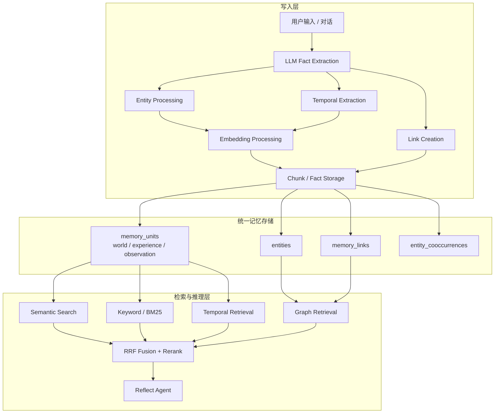
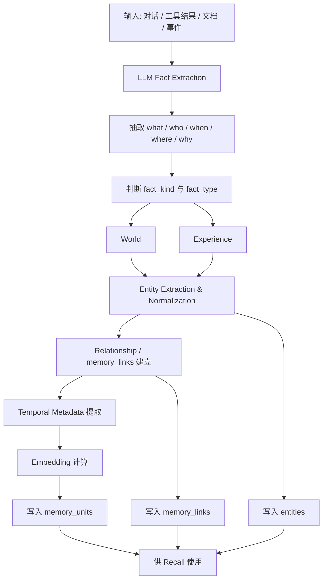
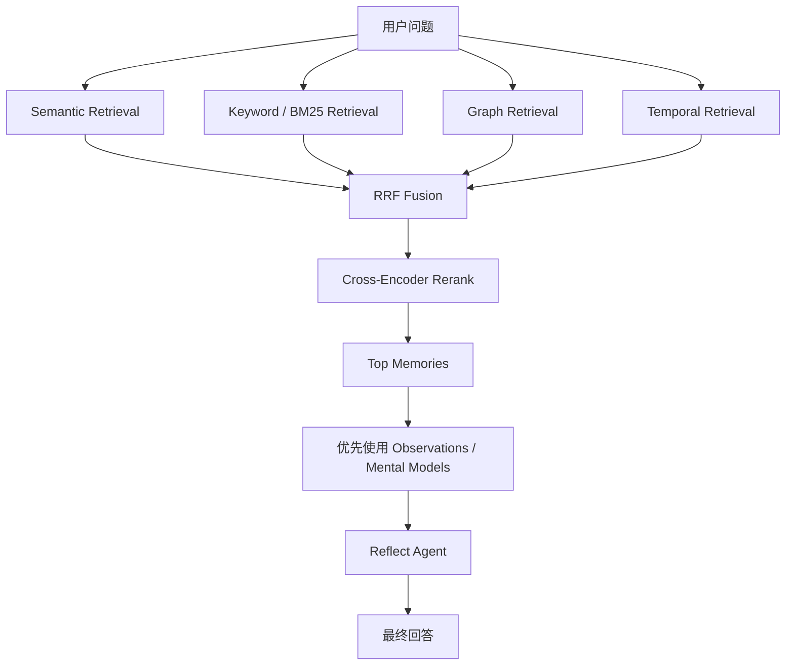
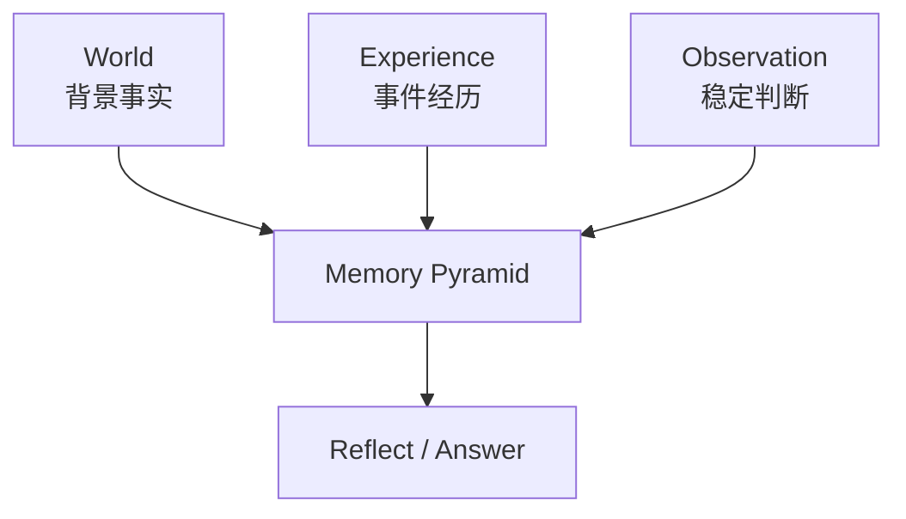
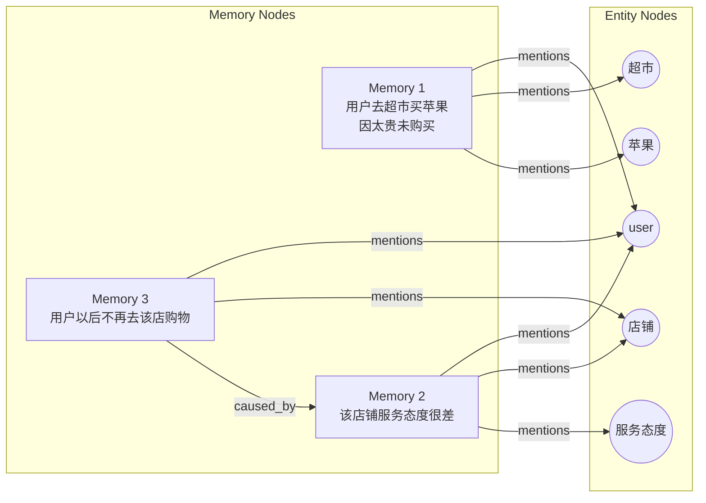
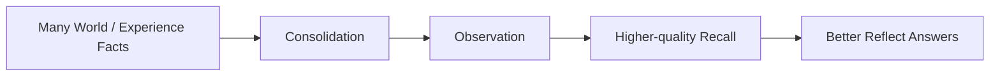

> 💡 **设计目标**
>
> - 让 Agent 随时间“学习”，而非只记住聊天内容
> - 提升长期记忆的准确率、可解释性与可演化性
>
> **架构摘要**
>
> Hindsight 不是把对话原文简单丢进向量库的 “长上下文 / RAG 记忆”，而是把输入内容先使用 LLM 进行抽取，加工成**结构化记忆单元；**再通过**多路检索 + 后台归纳**来支持 recall 和 reflect。它的核心技术路线可以概括为：
>
> 1. **retain**：用 LLM 抽取事实，补充实体、关系、时间等结构；
> 2. **store**：把记忆以 `world / experience / observation` 等类型落入统一 memory store；同时存储实体、记忆关系 等内容
> 3. **recall**：并行跑 semantic、keyword (BM25)、graph、temporal 四类检索，再融合重排；
> 4. **consolidation**：后台把多条原始记忆沉淀成更高层的 `observation`；
> 5. **reflect**：优先利用 mental models 和 observations，再下探到原始 facts 组织答案

---

## 一、Hindsight 是如何实现记忆系统的

### 1. 总体架构：不是 “聊天记录存档”，而是 “记忆加工流水线”

官方 README 把 Hindsight 定义为 agent memory system，强调目标是让 agent “learn over time”，而不是只 “remember conversation history”1。

从公开文档和源码结构看，它的核心工作流是：

- **retain**：写入记忆
- **recall**：检索记忆
- **reflect**：基于记忆进行更深层推理 / 回答
- **observation / mental models**：在后台持续把零散记忆沉淀成更稳定的认知层14。

这意味着它不是 “把原文 chunk 化后向量检索”，而是把输入转成一套**可检索、可归纳、可演化**的 memory graph /memory store。



| 层次 | 职责 | 关键技术 |
|-|-|-|
| 写入层 | 将输入转为结构化记忆 | LLM 抽取、实体归一化、关系建模、时间抽取、Embedding |
| 存储层 | 统一保存多类型记忆与辅助索引 | PostgreSQL、pgvector、实体表、记忆链接表 |
| 检索层 | 多路召回相关记忆 | Semantic、BM25、Graph、Temporal、RRF、Cross-Encoder |
| 沉淀层 | 从碎片事实中生成稳定观察 | Consolidation、proof_count、source memories |
| 推理层 | 组织高质量回答 | Reflect Agent、Mental Models、层级化检索 |

---

### 2. retain：记忆写入时做了哪些处理

源码里 retain 模块的边界已经非常清晰，相关子模块包括：

- `fact_extraction`
- `embedding_processing`
- `entity_processing`
- `link_creation`
- `chunk_storage`
- `fact_storage`

这说明 retain 的真实流程大致是：

1. 输入文本 / 内容进入系统
2. 用 **LLM 抽取事实**
3. 识别并归一化 **实体**
4. 建立 **关系链接**
5. 抽取 / 记录 **时间信息**
6. 生成 **embedding**
7. 把结果落入统一 memory store

这些步骤与官方 retain 文档描述一致：retain 会把输入内容转换成关键 facts、temporal data、entities、relationships 和 search indexes，再供后续 recall /reflect 使用5。

所以从实现层面讲，Hindsight 的 “写记忆” 不是原样保存，而是一次**结构化知识提取**。

| 阶段 | 系统在做什么 | 产物 |
|-|-|-|
| Fact Extraction | 从原始输入中抽取可陈述事实，而不是直接存整段文本 | what / who / when / where / why / fact_kind |
| Type Assignment | 判定该事实是 world 还是 experience | fact_type |
| Entity Processing | 抽取事实中涉及的人、地点、项目、对象、属性 | entities |
| Link Building | 构造记忆与实体、记忆与记忆之间的关系边 | memory_links |
| Temporal Modeling | 把自然语言时间转为可检索时间范围 | occurred_start / occurred_end |
| Indexing | 同时建立向量检索和关键词检索能力 | embedding / sparse index |



---

### 3. Recall：多路检索架构

> 🔎 **Recall 的本质**
>
> Recall 不是单一路径的向量召回，而是语义、关键词、图关系、时间四路并行检索，再经过融合和 rerank，把最适合回答当前问题的记忆送入 reflect。

| 检索臂 | 为什么需要它 | 典型适用场景 |
|-|-|-|
| Semantic | 覆盖语义相近但字面不同的记忆 | 偏好、习惯、模糊语义问题 |
| Keyword / BM25 | 保留专有词、错误码、短语、精确字面匹配能力 | 项目名、代码名、报错、术语 |
| Graph | 沿实体和记忆关系边扩展相关上下文 | “和谁有关”“为什么发生” |
| Temporal | 让系统理解先后顺序、时间窗和最近性 | “上周发生了什么”“六月进展” |

> 💡 **融合层作用**
>
> RRF 负责把多路召回统一到同一排序空间，避免单一路径支配结果；Cross-Encoder 再结合 query 与 memory 做更精细的相关性重排。

> 📌 **回答层作用**
>
> 最终不是把 top-k 原文直接拼给模型，而是让 reflect 优先消费高层知识，再回落到 observation 和 raw facts。



---

### 4. 底层数据模型：统一 memory store + 多种辅助结构

源码数据模型显示，三类核心记忆都放在统一的 `memory_units` 表中，通过 `fact_type` 区分 `world`、`experience`、`observation`。同一个记忆单元还带有：

- 文本内容 `text`
- 向量 `embedding`
- 事件时间 `event_date`
- 时间范围 `occurred_start` / `occurred_end`
- 提及时间 `mentioned_at`
- 元数据 `metadata`

此外还有独立结构来支撑更复杂的检索与归纳：

- `entities`：实体
- `unit_entities`：记忆与实体的关联
- `memory_links`：记忆之间的关系边
- `entity_cooccurrences`：实体共现关系

这说明 Hindsight 的记忆本质上是一个**事实 + 实体 + 关系 + 时间 + 向量**的混合系统，而不是单纯向量数据库。

---

## 二、Hindsight 使用了哪些关键技术手段

### 1. LLM 事实抽取

Hindsight 的第一步不是 chunk embedding，而是 LLM 驱动的 **fact extraction**。官方 retain 文档明确说 retain 会抽取 key facts、temporal data、entities 和 relationships5。

这一步决定了它更像 “记忆理解系统”，而不是 “文本索引系统”。

---

### 2. 实体识别与实体归一化

记忆会和实体绑定，系统维护独立实体表、记忆 - 实体关联表以及实体共现表。这背后的作用是：

- 提高检索召回率
- 让 graph retrieval 成立
- 支持从 “人 / 项目 / 地点 / 对象” 维度追踪长期记忆

所以 Hindsight 不是只对文本做 embedding，也在做**实体级记忆建模**。

---

### 3. 关系建模 / 图结构

`memory_links` 中支持多种 link type，包括：

- `temporal`
- `semantic`
- `entity`
- `causes / caused_by`
- `enables`
- `prevents`

这说明 Hindsight 并非仅靠余弦相似度找 “像不像”，而是显式表达：

- 哪些记忆时间相关
- 哪些共享实体
- 哪些有因果关系
- 哪些会促进 / 阻止另一事件

因此它具备明显的**图检索**特征。

---

### 4. 时间建模

它记录的不只是 “文本出现时间”，而是区分：

- 事件发生日期
- 时间区间
- 被提及时间

Recall 文档也明确把 **temporal retrieval** 作为四大并行召回路径之一2。

这意味着 Hindsight 可以回答的不只是 “和某事有关的内容”，还包括 “某段时间发生了什么”“六月发生了什么” 这类时间感知问题1。

---

### 5. 向量检索

底层使用 `pgvector` 存 embedding，并结合 HNSW 索引进行 dense retrieval。官方 storage 文档明确写到 PostgreSQL + pgvector 是其核心存储方案之一6。

因此语义检索这部分是标准但成熟的路线：**Postgres + pgvector + ANN**。

---

### 6. BM25 / 关键词检索

Recall 并不只靠 embedding。官方文档明确写明 keyword retrieval 使用 **BM25**21。

这样做的价值很明确：

- 解决纯向量检索对精确词匹配不稳定的问题
- 对专有名词、代码、日期、短语更友好
- 与 semantic retrieval 互补

所以它本质是**hybrid retrieval**。

---

### 7. 图检索

Recall 的四条并行臂之一就是 **graph retrieval**。官方 README 明确点名 graph: entity /temporal/causal links1。

这和前面的 `memory_links` / `entity_cooccurrences` 数据结构是对齐的。也就是说，它不只是 “可以画图”，而是真正把图作为检索信号之一。

---

### 8. 多路融合与重排

Recall 不是把各路结果简单拼起来，而是：

1. 多路召回
2. **RRF（Reciprocal Rank Fusion）** 融合
3. **cross-encoder reranker** 重排

官方文档直接写明了这一点21。

这说明 Hindsight 的 retrieval 层是比较 “搜索系统化” 的实现，而不只是简易相似度排序。

---

### 9. 后台 consolidation /observation 生成

这是它与普通记忆系统差异很大的一点。

官方 observations 文档明确说明：retained facts 不会永远以扁平事实堆存在，而是会在后台被整合为 **observations**；每个 observation 保留 supporting evidence 和 proof count，并会随着新证据不断 refine3。

这意味着它在做一种**后台知识沉淀**：

- 原始事实保留
- 长期归纳结果生成
- 新证据进来后持续修订

这比普通 “会话摘要记忆” 更接近可演化知识系统。

---

### 10. reflect：分层记忆驱动的推理

reflect 阶段，Hindsight 不是直接 “检索后总结”，而是以不同层级的记忆作为工具源：

1. mental models
2. observations
3. raw facts

这说明 Hindsight 在回答问题时更偏向：

- 先用已经沉淀好的高阶知识
- 再回退到 observation
- 最后才查最底层原始事实

这是一种明显的**分层记忆架构**。

---

## 三、world、experience、observation 三类记忆分别是什么

| 类型 | 回答的问题 | 本质 | 形成方式 |
|-|-|-|-|
| World | 世界是什么样 | 背景事实、环境知识、稳定外部信息 | Retain 直接抽取 |
| Experience | 发生过什么 | 主体经历、动作过程、交互事件 | Retain 直接抽取 |
| Observation | 从这些事实里能归纳出什么 | 稳定判断、长期模式、高阶认知 | Consolidation 后台生成 |

| 维度 | World | Experience | Observation |
|-|-|-|-|
| 信息层级 | 基础事实层 | 事件过程层 | 归纳判断层 |
| 时间特征 | 可长期有效，也可阶段性成立 | 通常有明确发生过程 | 跨时间、多证据累积形成 |
| 稳定性 | 中高 | 单条事件稳定，但代表性有限 | 最高，但依赖证据更新 |
| 是否直接抽取 | 是 | 是 | 否，需要 consolidation |
| 回答中的角色 | 提供背景约束 | 提供案例和证据 | 提供高阶判断与总结 |



> 🌍 **World**
>
> 更像“上下文条件”和“外部世界状态”，例如身份、偏好、项目约束、环境知识。

> 🎬 **Experience**
>
> 更像“发生过的具体事件”，例如尝试、执行过程、交互经过、结果反馈。

> 🔭 **Observation**
>
> 更像“从多条事实中抽出的稳定规律”，例如偏好模式、行为倾向、长期结论。

---

## 四、记忆、实体、memory_links 三者之间的关系

> 🧠 **一句话理解**
>
> **记忆**是系统真正保存和检索的事实单元，**实体**是这些事实里反复出现的对象锚点，**memory_links** 是把记忆与实体、记忆与记忆组织成图结构的关系边。

| 对象 | 定义 | 核心作用 |
|-|-|-|
| Memory | 系统真正保存的 “事实单元”，是回答问题时被检索、排序、推理的核心对象。 | 承载 what / who / when / where / why 等事实内容，供 recall 和 reflect 直接使用 |
| Entity | 从记忆里抽出来的 “对象锚点”，比如人、地点、物品、店铺、属性，用来把不同记忆挂到同一个语义节点上。 | 把多条记忆挂接到同一个对象上，支撑 graph retrieval |
| memory_links | 记忆之间、记忆与实体之间形成的 “关系边”，**让系统不只是存碎片文本，而是存成一个可遍历的关系网络**；Hindsight 的数据模型确实包含 `memory_units`、`entities`、`memory_links` 这类核心结构。 | 表达涉及关系、因果关系、来源关系、共现关系，形成可遍历的 memory graph |

| 例子中的内容 | 在系统里会落成什么 |
|-|-|
| “用户昨天去超市买苹果，觉得太贵没有买” | 一条 memory，连接 user、超市、苹果 三个 entity |
| “该店铺服务态度很差” | 一条 memory，连接 user、店铺、服务态度 三个 entity |
| “用户表示以后再也不去这家店铺买东西” | 一条 memory，连接 user、店铺 两个 entity，并通过 caused_by 链接到上一条 memory |

> ✅ **因此三者的关系可以概括为**
>
> memory 是**内容节点**，entity 是**共享对象节点**，memory_links 是**连接节点之间的边**；三者合在一起，原始事实才会变成可检索、可扩展、可推理的长期记忆网络。

---

## 五、示例

用户输入“**我昨天去超市买了苹果，苹果一斤 10 块钱，我觉得太贵了，没有买。另外这家店铺的服务态度很差，以后我再也不去这家店铺买东西了。**”，Hindsight 抽取出以下记忆。

```json
{
  "facts": [
    {
      "what": "用户昨天去超市买苹果，苹果一斤10块钱，用户觉得太贵没有买",
      "when": "2026年9月28日",
      "where": "超市",
      "who": "user",
      "why": "N/A",
      "fact_kind": "event",
      "occurred_start": "2026-09-28T00:00:00+00:00",
      "occurred_end": "2026-09-28T00:00:00+00:00",
      "fact_type": "world",
      "entities": ["user", "超市", "苹果"]
    },
    {
      "what": "该店铺服务态度很差",
      "when": "N/A",
      "where": "N/A",
      "who": "user",
      "why": "N/A",
      "fact_kind": "conversation",
      "fact_type": "world",
      "entities": ["user", "店铺", "服务态度"]
    },
    {
      "what": "用户表示以后再也不去这家店铺买东西",
      "when": "N/A",
      "where": "N/A",
      "who": "user",
      "why": "因为该店铺服务态度很差",
      "fact_kind": "conversation",
      "fact_type": "world",
      "entities": ["user", "店铺"],
      "causal_relations": [
        {
          "target_index": 1,
          "relation_type": "caused_by"
        }
      ]
    }
  ]
}

```



> 🧠 **记忆：回答时真正被引用的内容块**
>
> 记忆保存的是完整 fact，包括：
>
> - what
> - who
> - where
> - when
> - why
> - fact_type
> - 时间元数据
> - embedding / 稀疏索引等检索信息
>
> 也就是说，**记忆负责表达 “发生了什么”**。

> 📍 **实体：让系统知道 “这些记忆在说同一个东西”**
>
> 用于把多条记忆挂到同一对象上，帮助系统围绕人、店铺、物品组织上下文。
>
> 实体更像是统一索引和图检索的锚点。
>
> 比如这里的 `超市` 和 `店铺`，如果归一化策略做得更强，系统甚至可能判断它们是同一商业对象的不同表述，进一步把相关记忆聚合起来。也就是说，**实体负责表达 “这些记忆围绕谁 / 什么展开”**。

> 🔗 **memory_links：让系统知道 “它们彼此怎么相关”**
>
> 它把系统从 “记忆列表” 升级成 “记忆图谱”：
>
> - 某条记忆涉及哪些实体
> - 哪两条记忆互相支持
> - 哪条记忆导致了另一条记忆
> - 哪条记忆是某条 observation 的证据来源

从实现角度看，Hindsight 会把记忆存入 **memory_units**，把对象抽成 **entities**，再通过 **memory_links** 组织成可扩展的图式结构，这正是它能支持 graph retrieval 和 observation consolidation 的基础[[Storage docs]](https://hindsight.vectorize.io/developer/storage)。

> 🚀 **价值**
>
> - 把零散事实升级为可复用判断
> - 减少回答时只拼碎片记忆
> - 让系统逐渐形成稳定认知，而不是永远停留在原始日志层
> - 为 mental models 提供更高质量输入

> 💡 **如果没有 observation**
>
> - 系统只能记住很多事实，却不容易形成总结
> - 每次回答都要重新从原始记忆里临时拼装结论
> - 召回结果会更碎，解释成本更高
> - 长期行为模式很难稳定沉淀



---
